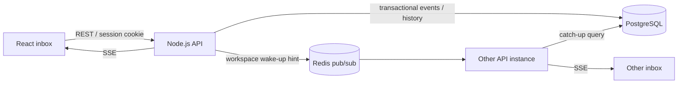

# SignalDesk design

Written before implementation. Selected candidate: real-time activity/notification system.

## Career fit and decision

SignalDesk is a team inbox for deployment updates, incidents, and announcements. It complements existing Python ERP/RAG work with long-lived Node.js HTTP connections, async I/O, event fan-out, reconnect recovery, and flow control. The project is small enough for one developer to explain end to end. Scores below are subjective portfolio judgments, not measurements or hiring guarantees.

| Criterion | Real-time feed | API gateway | File processor | Queue from scratch | npm CLI |
| --- | ---: | ---: | ---: | ---: | ---: |
| Junior job relevance | 10 | 7 | 8 | 8 | 7 |
| Node knowledge | 9 | 10 | 10 | 9 | 9 |
| Resume impact | 9 | 8 | 8 | 8 | 7 |
| Recruiter clarity | 10 | 6 | 9 | 6 | 8 |
| Depth | 8 | 9 | 9 | 10 | 7 |
| Engineering practices | 9 | 9 | 9 | 9 | 8 |
| Demo | 10 | 6 | 8 | 6 | 7 |
| Distinction | 9 | 9 | 9 | 9 | 8 |
| Manageable scope | 8 | 6 | 9 | 5 | 9 |
| Interview explainability | 9 | 7 | 9 | 6 | 9 |
| Total | 91 | 77 | 88 | 76 | 79 |

The file processor is the runner-up: excellent Node streams material, but a team inbox offers a stronger full-stack demonstration. The gateway and custom queue introduce infrastructure correctness work that can crowd out a polished product. A CLI is focused but demonstrates fewer of the web-application skills targeted here.

## MVP

- Register a workspace/admin and log in/out using revocable opaque sessions.
- Admin provisions member accounts; both roles read their own workspace feed.
- Admin publishes deployment, incident, and announcement events.
- Durable events, per-user read receipts, paginated REST history.
- Live SSE delivery with reconnect cursor, bounded batches, slow-client timeout, and periodic database reconciliation.
- Redis fan-out between API instances; no loss of stored events if a hint is missed.
- React inbox, creation form, connection indicator, unread filtering, and history navigation.
- Validation, structured logs, request IDs, health/readiness, graceful shutdown, tests, Docker, CI, API documentation.

## Components and why

TypeScript provides strict application contracts. Express supplies HTTP routing. PostgreSQL supplies durable relational data and transactions. Redis pub/sub wakes API instances with active connections. React/Vite builds the interactive inbox. Node's crypto API hashes passwords asynchronously and creates cryptographically random session tokens. Zod validates untrusted inputs. No ORM, WebSocket library, broker, background worker, or Kubernetes is required.

## Data and access

Workspace has a transactional next-event counter. User belongs to one workspace and has admin/member role. Session stores a token hash, user ID, and expiry; the browser gets an HttpOnly cookie. Event stores a UUID, workspace ID, sequence, title/body/type, actor, and creation time. Read receipt is unique by event and user. All event reads and updates constrain workspace ID. Session tokens and passwords never appear in logs.

## Event flow and guarantees

1. Authenticate, enforce admin role, and validate the request.
2. In one PostgreSQL transaction, increment the workspace counter and insert the event. Updating the same workspace row serializes competing publishers; committed cursors cannot skip a lower-sequence event still waiting to commit.
3. After commit, publish a workspace hint to Redis. Publishing failure is logged but does not turn a committed operation into an apparent failure.
4. Each instance wakes its local subscribers and queries durable events after their cursors in ascending order.
5. Every few seconds, connected subscribers reconcile even without a Redis hint. Clients reconnect with the last received cursor; rendering deduplicates event IDs.

Redis pub/sub is at-most-once. This design does not claim exactly-once delivery. Replays can duplicate deliveries; PostgreSQL remains authoritative. A bounded batch and waiting for writable drain limit memory growth. Connection lifetime, authentication rechecks, per-user connection caps, and per-instance caps bound resource usage.

## Security and operations

Same-origin browser UI and API; production requires HTTPS and Secure cookies. Mutation requests with a browser Origin must match the configured origin; SameSite cookies provide an additional boundary. Parameterized SQL; validation and body limits; opaque random session tokens hashed at rest; async scrypt; coarse per-instance authentication throttling. Do not trust forwarded IPs by default. Shared throttling and sophisticated abuse protection are stretch work.

Structured JSON logs include request IDs, status, and latency but omit bodies, passwords, cookies, and database/Redis URLs. Liveness is process status; readiness checks PostgreSQL and reports Redis status. Existing streams can reconcile during Redis outages. Shutdown stops new requests, ends SSE connections, closes Redis/DB resources, and has a hard deadline.

## Non-goals and stretch work

No email/mobile push, scheduling, password recovery, OAuth, file attachments, rich HTML, or public deployment claim. Stretch: invitations, external ingestion keys with idempotency, cross-tab read synchronization, retention, shared throttling, and measured load testing. At higher load, batch per-workspace reads instead of querying per connection; measure before adding infrastructure.

## Repository and commit plan

`server/` configuration, domain services, adapters, HTTP and SSE; `client/` React; `db/` SQL migrations; `tests/` unit/API/integration; `docs/` design and OpenAPI. Conventional commits follow actual completed stages: design/tooling, schema, authentication, API, Redis/SSE, dashboard, integration tests, container/CI/docs. Tests should accompany the behavior they protect, rather than being deferred solely to a final test commit.

## Verification boundaries

The initial environment has Node 24 but blocks npm network downloads and does not expose Docker. Dependency installation, infrastructure integration, and browser verification must be reported separately from dependency-free tests and static checks. A CI definition is not evidence of a successful CI run.

## Reference sources

- https://redis.io/docs/latest/develop/use-cases/pub-sub/
- https://nodejs.org/en/learn/asynchronous-work/dont-block-the-event-loop
- https://nodejs.org/api/stream.html
- https://www.postgresql.org/docs/18/explicit-locking.html
- https://bg.linkedin.com/jobs/view/junior-javascript-fullstack-engineer-at-intellias-4438146321
